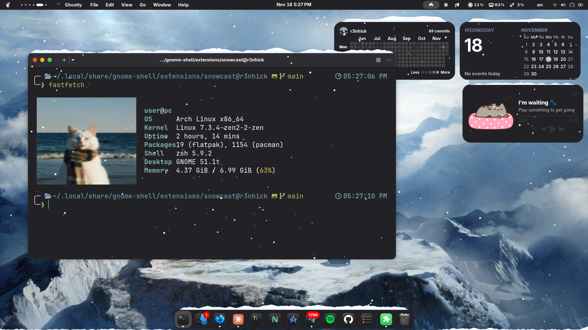

# Snowcast ❄️

Розширення для GNOME Shell 45–51: сніг на робочому столі.



- **Сніжинки.** Падають поверх вікон, з вітром і поривами. Напрямок задається мишкою: значок сніжинки → «Напрямок снігу…».
- **Гірки снігу на вікнах, доці й віджетах.** Горби мають різну висоту, на заокруглені кути сніг не лягає.
- **Фізика:**
  - якщо вікно звузити, сніг із прибраної частини падає;
  - при різкому русі вікна сніг ковзає по інерції;
  - якщо смикнути вікно вниз, сніг плавно підстрибує;
  - коли вікно закривають чи згортають, сніг обсипається на вікна нижче.
- **Кучугури внизу екрана і машинка-снігоприбиральник.** Машинка заїжджає на док. На віджетах їздить маленька машинка.
- **Теплий курсор.** Топить сніг, над ним піднімається пара.
- **Сніг в огляді (Super)** видно так само, як віджети.
- **Головний перемикач Snowcast** у меню вимикає все, а саме розширення лишається ввімкненим. **Snowfall** вимикає лише падіння снігу: той, що вже ліг, лишається.

Підтримуються Dash to Dock, Ubuntu Dock, dash2dock-lite і віджети Desktop Widgets.

## Мови / Languages / Diller

Інтерфейс доступний англійською (US), українською і турецькою. Мова вибирається автоматично, за мовою системи.

*Snowcast speaks English, Ukrainian and Turkish — the language follows your system locale.*

Як додати переклад: скопіюйте `po/snowcast@r3nhick.pot` у `po/<мова>.po`, перекладіть рядки й скомпілюйте:

```
msgfmt po/<мова>.po -o locale/<мова>/LC_MESSAGES/snowcast@r3nhick.mo
```

## Встановлення

```
git clone https://github.com/r3nhick/snowcast.git ~/.local/share/gnome-shell/extensions/snowcast@r3nhick
glib-compile-schemas ~/.local/share/gnome-shell/extensions/snowcast@r3nhick/schemas
```

Вийдіть із сеансу, увійдіть знову і виконайте:

```
gnome-extensions enable snowcast@r3nhick
```

## Налаштування

Значок сніжинки на верхній панелі → «Налаштування…», або:

```
gnome-extensions prefs snowcast@r3nhick
```
